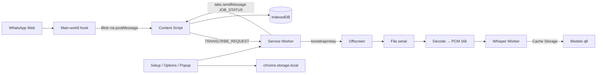

# Arquitetura

## Visão geral

A extensão é um pipeline local: o WhatsApp Web materializa áudios como `Blob` no main world; o content script correlaciona blob ↔ mensagem e enfileira jobs; o service worker só faz bootstrap e relay; o **documento offscreen** é o dono da fila, do decode OGG→PCM e do Web Worker Whisper. Config fica em `chrome.storage.local`; transcrições em IndexedDB; pesos do modelo em Cache Storage.

## Diagrama do sistema

## Componentes

**Service worker** (`src/background/service-worker.ts`) — thin: `onInstalled` abre setup, garante offscreen, roteia mensagens para o offscreen, persiste lifecycle do modelo em `chrome.storage`, faz badge e `tabs.sendMessage` de `JOB_STATUS` para abas do WhatsApp.

**Offscreen** (`src/offscreen/`) — componente persistente: fila (`stt/queue.ts`), decode (`stt/audio-decode.ts`), host do worker. Não usa `chrome.storage` (indisponível nesse contexto); emite eventos `PROGRESS` / `READY` / `JOB_STATUS` para o SW.

**Whisper worker** (`src/stt/whisper-worker.ts`) — Transformers.js pipeline, `device: 'wasm'` (q8 no WebGPU alucina em loop; ver transformers.js#1317), `dtype: 'q8'`, `language: 'pt'`.

**Content MAIN** (`src/content/main-world.ts`) — hooks em `URL.createObjectURL`, `fetch` e XHR; filtra candidatos a áudio (magic bytes / MIME) e posta `AUDIO_BLOB` para o isolated world.

**Content ISOLATED** (`src/content/whatsapp.ts`, `audio.ts`, `ui.ts`, `selectors.ts`) — scan de balões, UI híbrida, bind `messageId`↔blob, auto dos últimos 3 áudios, hydrate IndexedDB ao trocar chat. Nunca dispara play para capturar.

**Setup / Options / Popup** — UX de modelo, progresso, toggles e limpeza de cache.

## Fluxo de dados (transcrição)

1. Usuário (ou auto) dispara enqueue no content script.
2. `obtainBlobForMessage` resolve bytes via mapa por `messageId`, `fetch(audio.src)` ou claim de unclaimed (só auto) — **sem clique em play**.
3. Content envia `TRANSCRIBE_REQUEST` (áudio em base64) via `chrome.runtime.sendMessage`.
4. SW garante offscreen e encaminha com `_to: 'offscreen'`.
5. Offscreen enfileira (manual unshift / auto push), decodifica para PCM mono 16 kHz, manda ao worker.
6. Worker devolve texto; offscreen grava IndexedDB e emite `JOB_STATUS`.
7. SW retransmite `JOB_STATUS` às abas `web.whatsapp.com`; UI atualiza o balão.

## Dependências externas

| Serviço | Propósito | Docs |
|---------|-----------|------|
| WhatsApp Web | DOM + blobs de áudio | https://web.whatsapp.com |
| Hugging Face / CDN | Download dos pesos Whisper ONNX | modelos em `src/stt/models.ts` |
| Chrome Extension APIs | SW, offscreen, storage, tabs | MV3 docs |

## Key Decisions

Decisões detalhadas em [docs/adr/](adr/). Resumo:

- Fila no **offscreen**, não no SW — SW é efêmero.
- STT **in-browser** (Transformers.js + Whisper), não API cloud.
- Captura via **MAIN-world hook** + fetch; sem play programático.
- **Sem COOP/COEP** — evita `blob:` workers bloqueados pelo CSP.
- Transcrições em **IndexedDB**; config em **storage.local**.
- Idioma STT fixo **PT-BR**; modelo default **base** q8.

Plano de produto original: [plano-whatsapp-web-transcriber.md](plano-whatsapp-web-transcriber.md).
