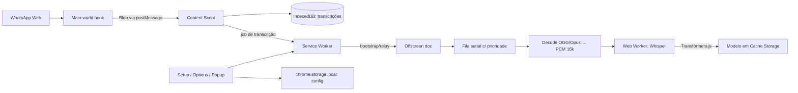
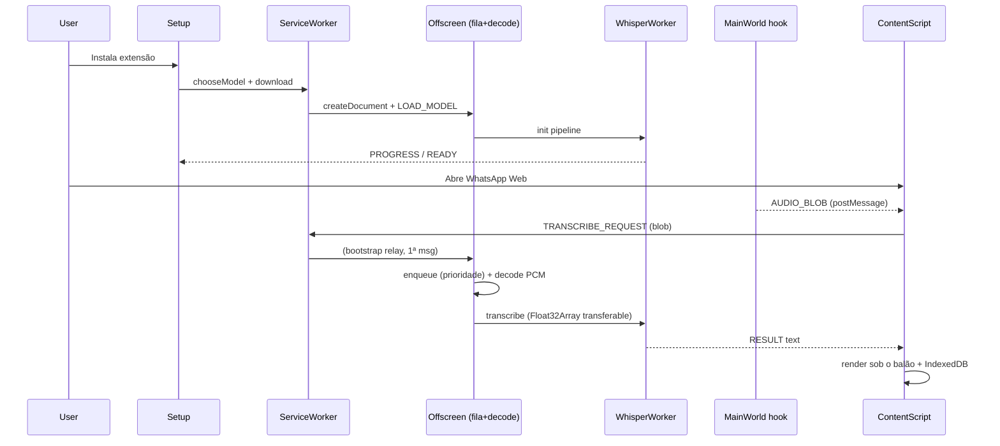

# WhatsApp Web Transcriber — Plano

**Goal:** Extensão Chrome que transcreve áudios do WhatsApp Web localmente (privacidade), com setup de modelo na instalação e modo híbrido (novos automáticos / histórico sob demanda).

**Architecture:** Content script (isolated + main world) no `web.whatsapp.com` captura áudios e injeta UI; service worker faz bootstrap e lifecycle; **offscreen document é o dono da fila** e hospeda decode + Web Worker com `@huggingface/transformers` (Whisper, WebGPU → fallback WASM); setup/options/popup gerenciam modelo e preferências; config em `chrome.storage.local`, transcrições em IndexedDB, modelo em Cache Storage.

**Tech stack:** Manifest V3, TypeScript, Vite + `@crxjs/vite-plugin`, `@huggingface/transformers` v3, modelos `onnx-community/whisper-{tiny,base,small,medium}` (ou `Xenova/whisper-*`) com `dtype: 'q8'`, `chrome.storage.local` (config) + IndexedDB (transcrições) + Cache Storage (modelo).

---

## Design aprovado

### 1. Arquitetura



- **Main-world hook:** script `world: "MAIN"` captura os `Blob` de áudio que o próprio WhatsApp cria (ver §4.1).
- **Content script (isolated):** detecta balões, injeta UI, correlaciona `<audio>` ↔ Blob, modo híbrido.
- **Service worker:** *thin* — `onInstalled` → setup, garante offscreen criado, relay de bootstrap. **Não guarda fila** (SW morre após ~30s idle).
- **Offscreen document:** componente persistente — dono da fila serial, decode de áudio, hosting do worker, watchdog.
- **Web Worker:** roda Transformers.js + Whisper (`device: 'webgpu'` → fallback `'wasm'`).
- **Setup / Options / Popup:** escolha/troca de modelo, progresso, toggles, status.
- **Privacidade:** áudio e modelo ficam no dispositivo; nada vai para API de STT externa.

### 2. Setup na instalação (UX)

Ao instalar (ou na primeira abertura sem modelo pronto), a extensão abre uma **página de setup** (`setup.html`).

1. **Boas-vindas** — “Transcreve áudios do WhatsApp Web no seu PC. Nada de áudio sai do browser.”
2. **Escolha do modelo** — combo Whisper com tamanho + qualidade + velocidade:
   - `tiny` — mais rápido, menos preciso
   - `base` — equilibrado (**recomendado**, default)
   - `small` — melhor qualidade, mais lento/pesado
   - `medium` — opcional, com aviso de máquina forte
3. **Baixar e preparar** — barra de progresso (% + “Baixando… / Carregando na memória…”).
4. **Pronto** — “Modelo carregado e pronto.” + CTA “Abrir WhatsApp Web”.
5. Enquanto não estiver `ready`, o WhatsApp mostra: “Conclua o setup da extensão para transcrever.”
6. **Retomada:** se o usuário fechar a aba durante o download, reabrir o setup continua de onde parou (arquivos parciais ficam em Cache Storage).

Troca de modelo depois: nas **Opções**, com confirmação de novo download. **Popup** (ícone da toolbar) mostra status do modelo, toggle rápido “transcrever novos automaticamente” e atalhos para setup/opções.

### 3. UX no WhatsApp Web

**Histórico (sob demanda):** botão “Transcrever” em cada áudio → “Transcrevendo…” → texto abaixo do balão (selecionável/copiável). Erro com “Tentar de novo”.

**Áudios novos (automático):** ao entrar na conversa aberta (modelo `ready` + toggle “auto” ligado), entram na fila com “Na fila…” → “Transcrevendo…” → texto. Fila processa 1 áudio por vez.

**Regras:**
- Cache evita reprocessar (com “Re-transcrever” discreto, que invalida o cache e re-enfileira com prioridade).
- Modelo não pronto → “Configurar extensão”.
- Áudio não capturado/ainda não carregado → “Áudio ainda não disponível”.
- **Prioridade da fila:** clique manual do usuário passa na frente de jobs automáticos.
- **Cancelar:** job em andamento pode ser cancelado (resultado descartado; flag checada entre chunks).
- Áudios longos (>30s) usam chunking do Whisper; UI mostra spinner indeterminado (progresso por chunk é nice-to-have).

### 4. Pipeline técnico

#### 4.1 Captura do áudio (componente mais crítico)

O `<audio>` dos balões aponta para `blob:https://web.whatsapp.com/...` criado no **main world** da página — o content script (isolated world) não tem referência ao `Blob`. Estratégia em camadas:

1. **Principal — hook no main world** (`content/main-world.ts`, `world: "MAIN"`, `run_at: document_start`):
   ```ts
   const orig = URL.createObjectURL.bind(URL);
   URL.createObjectURL = (obj: Blob | MediaSource) => {
     const url = orig(obj as Blob);
     if (obj instanceof Blob && obj.type.startsWith('audio/')) {
       window.postMessage({ source: 'wt', type: 'AUDIO_BLOB', url, blob: obj }, '*');
     }
     return url;
   };
   ```
   Blob é structured-cloneable → atravessa `postMessage` para o content script, que mantém `Map<blobUrl, Blob>`. Voice notes do WhatsApp são `audio/ogg; codecs=opus`.
2. **Fallback — fetch do src:** `fetch(audioEl.src)` no content script funciona para blob URLs do mesmo origin enquanto o blob não for revogado.
3. **Correlação:** o content script encontra o `<audio>` dentro do balão, lê `audioEl.src` e consulta o `Map`. Sem match → UI “Áudio ainda não disponível”.
4. **Não quebramos E2E:** usamos apenas mídia que o próprio cliente WhatsApp já descriptografou e materializou no browser (o mesmo blob que ele toca). Não interceptamos rede nem criptografia.
5. **Fora do MVP:** forçar download de mídia não carregada via módulos internos do WhatsApp (webpack `Store`/`downloadMedia`) — poderoso, mas frágil e invasivo.

#### 4.2 Decodificação (obrigatória — Whisper não decodifica OGG no browser)

No offscreen (`stt/audio-decode.ts`), antes de chamar o worker:

```ts
export async function decodeToPcm16k(blob: Blob): Promise<Float32Array> {
  const buf = await blob.arrayBuffer();
  const ctx = new OfflineAudioContext(1, 1, 16000);
  const audio = await ctx.decodeAudioData(buf); // OGG/Opus ok no Chrome; resample p/ 16kHz
  // se >1 canal, fazer downmix (média) — voice notes já são mono
  return audio.getChannelData(0);
}
```

O `Float32Array` vai ao worker como **transferable** (zero-copy).

#### 4.3 Worker Whisper (Transformers.js v3)

```ts
import { pipeline, env } from '@huggingface/transformers';
env.useBrowserCache = true; // modelo persiste em Cache Storage entre sessões

const asr = await pipeline('automatic-speech-recognition', modelId, {
  device: webgpuAvailable ? 'webgpu' : 'wasm',
  dtype: 'q8',                    // quantizado: ~4x menos download/RAM
  progress_callback: reportToSetup, // % de download/carregamento
});

const out = await asr(pcm, {
  language: 'pt',
  task: 'transcribe',
  chunk_length_s: 30,   // áudios >30s: chunking com stride
  stride_length_s: 5,
});
```

- **WASM multi-thread (SharedArrayBuffer):** exige cross-origin isolation das páginas da extensão → manifest com `cross_origin_embedder_policy: require-corp` + `cross_origin_opener_policy: same-origin`. Validar no scaffold que o CDN do Hugging Face (serve `Access-Control-Allow-Origin: *`) não é bloqueado; se houver problema, cair para single-thread com aviso “modo compatibilidade (mais lento)”.
- **Watchdog:** timeout por job = `max(2min, 4× duração do áudio)` em WASM. Estouro → `worker.terminate()` + novo Worker → re-enfileira 1× → depois marca erro honesto.
- **Chave de cache da transcrição:** `data-id` do elemento de mensagem (`el.closest('[data-id]')`), ex.: `true_5511…@c.us_ABC123`.

#### 4.4 Orquestração e fila (offscreen, não SW)

1. Content script envia `TRANSCRIBE_REQUEST { messageId, blobUrl? }` + Blob.
2. **Bootstrap:** SW recebe a 1ª mensagem, garante `chrome.offscreen.createDocument({ reasons: ['WORKERS'] })`, e re-encaminha a mensagem pendente (handshake). Depois disso o offscreen escuta `chrome.runtime.onMessage` diretamente.
3. Offscreen enfileira `{ messageId, blob, priority }` — fila serial, **manual > automático**, dedupe por `messageId` (Set em memória + consulta ao IndexedDB).
4. Decode → worker → texto.
5. Texto salvo no IndexedDB e devolvido ao content script → render sob o balão.
6. Se o Chrome matar o offscreen (low memory), o SW recria sob demanda na próxima mensagem.

### 5. Privacidade, erros e verificação

- Áudio e transcrição não saem do dispositivo.
- Rede só para download do modelo (Hugging Face) + tráfego normal do WhatsApp.
- Opções: “Apagar transcrições salvas” (limpa store IndexedDB), “Apagar modelo baixado” (limpa Cache Storage), mostrar espaço em disco (`navigator.storage.estimate()`); sem analytics no MVP.
- Mensagens humanas para: falha de download, CPU lenta, áudio indisponível, crash do worker (com retry automático 1× antes), ausência de WebGPU (info, não erro).

---

## Decisões travadas

| Tema | Escolha |
|------|---------|
| Escopo | Só WhatsApp Web |
| STT | In-browser Transformers.js v3 + Whisper (opção A) |
| Idioma | PT-BR fixo (`language: "pt"`, `task: "transcribe"`) |
| Trigger | Híbrido: novos auto (toggle) / histórico sob demanda |
| Modelo default | `base` quantizado (`dtype: 'q8'`) |
| Setup | Página full (`setup.html`) no `onInstalled` |
| Fila | Serial, **vive no offscreen doc**, com prioridade manual > auto |
| Captura de áudio | Hook `URL.createObjectURL` em `world: "MAIN"` + fallback `fetch(audioEl.src)` |
| Decode | `OfflineAudioContext.decodeAudioData` → PCM mono 16kHz no offscreen |
| Transcrições | IndexedDB (storage.local é só config — quota ~10MB) |
| Cache do modelo | Cache Storage via `env.useBrowserCache` |
| WASM threads | COOP/COEP no manifest (cross-origin isolation) |
| Rede | Só download do modelo (HF); áudio nunca sai |

---

## Estrutura de arquivos

```
manifest.config.ts               # MV3: host web.whatsapp.com; storage, offscreen; COOP/COEP; content scripts (ISOLATED + MAIN)
src/
  background/service-worker.ts   # onInstalled → setup; garante offscreen; relay de bootstrap
  offscreen/offscreen.html|ts    # DONO DA FILA; decode; hosting do worker; watchdog
  stt/whisper-worker.ts          # Transformers.js pipeline (WebGPU → WASM, q8)
  stt/models.ts                  # catálogo tiny/base/small/medium + dtype + metadados UX
  stt/queue.ts                   # fila serial c/ prioridade, dedupe, cancel
  stt/audio-decode.ts            # Blob → Float32Array 16k mono (OfflineAudioContext)
  content/whatsapp.ts            # MutationObserver em #main, modo híbrido, wiring
  content/main-world.ts          # hook URL.createObjectURL (world: "MAIN")
  content/selectors.ts           # seletores com fallbacks (módulo isolado)
  content/ui.ts                  # botão / estados / texto sob o áudio
  content/audio.ts               # correlação <audio>↔Blob (Map), fallback fetch(src)
  setup/setup.html|ts|css        # onboarding + combo + progresso + “pronto”
  options/options.html|ts        # trocar modelo, toggle auto, apagar cache/modelo, disco usado
  popup/popup.html|ts            # status do modelo + toggle rápido + atalhos
  shared/messages.ts             # protocolo tipado (discriminated unions)
  shared/storage.ts              # chrome.storage.local: modelId, status, progresso, prefs
  shared/db.ts                   # IndexedDB: transcripts { messageId → {text, ts, modelId} }
README.md
docs/
  plano-whatsapp-web-transcriber.md
```

---

## Fluxo principal



---

## Tasks de implementação

### 1. Scaffold da extensão

- [ ] Vite + CRXJS + TypeScript; manifest MV3 com `content_scripts` em `https://web.whatsapp.com/*` (um `ISOLATED`, um `world: "MAIN"` com `run_at: document_start`), permissões `storage`, `offscreen`, e `cross_origin_embedder_policy`/`cross_origin_opener_policy`.
- [ ] Smoke test de cross-origin isolation: download do modelo do HF funcionando com COEP ativo (senão, flag single-thread).
- [ ] Scripts npm: `dev`, `build`. README: carregar `dist/` em `chrome://extensions`.

### 2. Storage + catálogo de modelos

- [ ] `models.ts`: tiny/base/small/medium com label, tamanho aprox. (q8), qualidade/velocidade, id HF, dtype.
- [ ] `storage.ts` (config): `modelId`, `modelStatus` (`idle|downloading|loading|ready|error`), `downloadProgress`, `autoTranscribe` (default `true`).
- [ ] `db.ts` (IndexedDB): store `transcripts` keyed por `data-id` → `{ text, ts, modelId }`; `clear()`.

### 3. Setup UX (pós-instalação)

- [ ] `chrome.runtime.onInstalled` (`reason === 'install'`) → `chrome.tabs.create({ url: setup.html })`; reabrir se status ≠ `ready`.
- [ ] UI: boas-vindas + privacidade; `<select>` (base pré-selecionado); “Baixar e preparar”; barra de progresso; “Modelo carregado e pronto”; CTA “Abrir WhatsApp Web”.
- [ ] Erro de download: mensagem humana + retry; retomada de download parcial ao reabrir.
- [ ] Badge/ícone da action refletindo `ready` vs pendente.

### 4. Motor STT (offscreen + worker)

- [ ] Offscreen criado sob demanda (`reasons: ['WORKERS']`), recriado se morto.
- [ ] `audio-decode.ts`: Blob → PCM 16k mono; erro honesto para áudio corrompido.
- [ ] Worker: pipeline com `device` WebGPU → WASM, `dtype: 'q8'`, `progress_callback`, `language: 'pt'`, `chunk_length_s: 30`, `stride_length_s: 5`.
- [ ] Watchdog: timeout por job → terminate + restart + retry 1×.
- [ ] API de mensagens: `LOAD_MODEL`, `TRANSCRIBE`, `CANCEL`, eventos `PROGRESS`, `READY`, `RESULT`, `ERROR`.

### 5. Fila no offscreen

- [ ] `queue.ts`: serial, prioridade manual > auto, dedupe por `messageId`, skip se já há texto no IndexedDB, cancelamento de job corrente, broadcast de status ao content script.
- [ ] SW: handshake de bootstrap (garante offscreen + re-encaminha 1ª mensagem).

### 6. Content script WhatsApp

- [ ] `main-world.ts`: hook `URL.createObjectURL` filtrando `audio/*`; `postMessage` com Blob.
- [ ] `audio.ts`: `Map<blobUrl, Blob>`; correlação com `<audio>` do balão; fallback `fetch(src)`; limpeza de URLs revogadas.
- [ ] `selectors.ts`: seletores com lista de candidatos + `data-id` como chave; observer escopado a `#main` com debounce (DOM é parcialmente virtualizado — reaplicar UI ao re-render).
- [ ] Histórico: botão “Transcrever”; novos na conversa aberta: auto-enqueue se `ready && autoTranscribe`.
- [ ] UI: Na fila / Transcrevendo / texto / erro+retry / “Configurar extensão” / “Áudio ainda não disponível”; “Re-transcrever” discreto; cancelar.

### 7. Options + Popup

- [ ] Options: trocar modelo (confirma novo download), toggle “transcrever novos automaticamente”, “Apagar transcrições”, “Apagar modelo”, disco usado (`storage.estimate()`).
- [ ] Popup: status do modelo, toggle auto, atalhos (abrir WhatsApp / setup / opções).

### 8. Verificação manual

- [ ] Setup → progresso → “pronto”; fechar aba no meio do download → retomar.
- [ ] Histórico sob demanda + áudio novo automático; prioridade manual furando a fila.
- [ ] Áudio longo (>2min) com chunking; cancelamento no meio.
- [ ] Troca de modelo e re-download; “Apagar modelo” libera disco.
- [ ] Reload da aba: cache e status persistem; SW morto → transcrição ainda funciona (bootstrap relay).
- [ ] Máquina sem WebGPU → fallback WASM (aviso “modo compatibilidade”).
- [ ] Sem envio de áudio para API externa (devtools Network: só HF + WhatsApp).

---

## Riscos conhecidos (mitigações)

- **Captura de áudio quebrar com update do WhatsApp (risco #1):** duas estratégias independentes (hook main-world + fetch fallback); seletores isolados em `selectors.ts` com candidatos; falhar com UI honesta (“Áudio ainda não disponível”), nunca crashar.
- **DOM do WhatsApp muda / virtualização:** observer escopado + reaplicar UI em re-render; contagem local de misses para debug (sem telemetria externa).
- **Áudio criptografado / não materializado:** só transcrever mídia que o próprio cliente já descriptografou no browser.
- **SW morre no meio da fila:** fila vive no offscreen (persistente); SW é só bootstrap.
- **Offscreen morto por low memory:** recriar sob demanda na próxima mensagem.
- **WASM lento (sem threads ou sem WebGPU):** COOP/COEP para SharedArrayBuffer; `dtype: 'q8'`; aviso “modo compatibilidade”; default `base`.
- **Memória com `medium`:** aviso no combo; q8 obrigatório.
- **Quota de storage:** transcrições em IndexedDB; storage.local só para config.
- **Worker travado/áudio corrompido:** watchdog com restart + retry 1× → erro honesto.

---

## Fora do MVP (backlog)

- Tradução, resumo, busca nas transcrições, timestamps na UI.
- Forçar download de mídia não carregada (módulos internos do WhatsApp).
- Outros idiomas / auto-detecção; outros sites; sync na nuvem; analytics.
- Progresso percentual por chunk durante transcrição.
